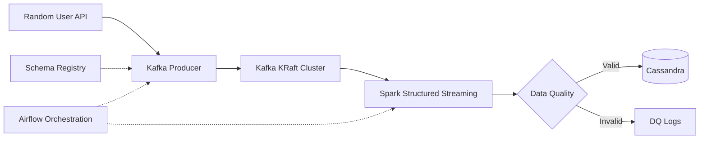

# Kafka to Cassandra | Micro-Batch Data Pipeline


An end-to-end, Dockerized data engineering pipeline that ingests synthetic user events from the [Random User API](https://randomuser.me/), publishes them to Apache Kafka, processes them with Spark Structured Streaming, and stores validated records in Apache Cassandra.

**Apache Airflow orchestrates the entire workflow using deferrable cross-DAG tasks.**

> **Project scope:** An orchestrated micro-batch pipeline designed to practice self-managed, open-source data engineering technologies rather than a continuously running, low-latency streaming system.

## Architecture



### Pipeline Workflow

1. **Ingestion:** Fetch synthetic user records from the Random User API and serialize events using JSON Schema.
2. **Event Streaming:** Publish messages to a three-broker Kafka KRaft cluster.
3. **Processing:** Read Kafka events using Spark Structured Streaming and deserialize JSON payloads.
4. **Data Quality:** Validate records and log invalid events by error category.
5. **Storage:** Persist valid user records to Apache Cassandra.
6. **Orchestration:** Coordinate ingestion and processing DAGs through Airflow's deferrable `TriggerDagRunOperator`.

## Tech Stack

| Component | Technology | Purpose |
|---|---|---|
| Orchestration | Apache Airflow 3.0 | DAG dependencies, scheduling, monitoring |
| Messaging | Apache Kafka (KRaft) | Distributed event streaming |
| Schema Management | Confluent Schema Registry | JSON Schema serialization |
| Data Processing | Apache Spark 3.5.3 / PySpark | Structured Streaming and transformations |
| Database | Apache Cassandra 5.0 | Distributed NoSQL storage |
| Metadata Database | PostgreSQL | Airflow metadata storage |
| Infrastructure | Docker Compose | Containerized local deployment |

## Engineering Highlights

### Kafka Ingestion
- Configured a three-broker Kafka cluster using KRaft without ZooKeeper.
- Implemented topic partitioning and replication with `replication.factor=3` and `min.insync.replicas=2`.
- Used `acks=all` and JSON Schema serialization for event publishing.

### Spark Structured Streaming
- Developed modular PySpark components for configuration, ingestion, transformation, validation, and storage.
- Implemented incremental micro-batch processing using `availableNow=True`.
- Configured persistent checkpoints to track processed Kafka offsets.
- Used `foreachBatch()` and the Spark Cassandra Connector to write validated records.

### Airflow Orchestration
- Designed a cross-DAG workflow coordinating Kafka ingestion and Spark processing.
- Integrated `SparkSubmitOperator` with a standalone Spark cluster.
- Implemented deferrable `TriggerDagRunOperator` tasks using Airflow Triggerer.
- Reduced observed end-to-end execution time from **323.35s to 171.20s** across two local test runs.

### Data Quality
- Implemented five validation rules:
  - `INVALID_ENVELOPE`
  - `INVALID_UUID`
  - `MISSING_FIRST_NAME`
  - `INVALID_EMAIL`
  - `KEY_MISMATCH`
- Tracked valid and invalid records per micro-batch.
- Excluded invalid records from Cassandra writes.

## Project Structure

```text
Realtime-data-streaming-pipeline/
├─ airflow/
│  ├─ config/
│  │  └─ simple_auth_manager_passwords.json.generated
│  ├─ dags/
│  │  ├─ schemas/
│  │  │  └─ randomuser.json
│  │  ├─ check_spark_kafka_dag.py
│  │  ├─ kafka_to_cassandra_dag.py
│  │  ├─ randomuser_batch_pipeline_dag.py
│  │  └─ randomuser_ingestion_dag.py
│  ├─ logs/
│  └─ plugins/
├─ cassandra/
│  └─ schema.cql
├─ docker/
│  └─ airflow.Dockerfile
├─ infra/
│  ├─ airflow/
│  │  └─ docker-compose.yaml
│  ├─ cassandra/
│  │  └─ docker-compose.yaml
│  ├─ kafka/
│  │  └─ docker-compose.yaml
│  └─ spark/
│     └─ docker-compose.yaml
├─ jobs/
│  └─ tests/
│     └─ publish_dq_events.py
├─ notes/
│  ├─ Airflow_Spark_Standalone.pdf
│  └─ Kafka_Ingestion_Pipeline.pdf
├─ schemas/
│  └─ randomuser.json
├─ spark/
│  ├─ jobs/
│  │  ├─ check_kafka_connector.py
│  │  └─ kafka_to_cassandra.py
│  ├─ __init__.py
│  ├─ config.py
│  ├─ quality.py
│  ├─ reader.py
│  ├─ session.py
│  ├─ transform.py
│  └─ writer.py
├─ .env
├─ .gitignore
├─ docker-compose.yaml
├─ pyproject.toml
└─ README.md
```

## Getting Started

### Prerequisites

- Docker Desktop and Docker Compose
- Python 3.12
- Sufficient memory to run Kafka, Spark, Airflow, and Cassandra
- Locally built Airflow and Spark images referenced by Docker Compose

### 1. Configure Environment

Set the required environment variables in a local `.env` file, including:

```env
AIRFLOW_JWT_SECRET=<your-secret>
KAFKA_CLUSTER_ID=<your-kafka-cluster-id>
```

Do not commit `.env` or other credentials to version control.

### 2. Start Services

From the repository root:

```bash
docker compose config --quiet
docker compose up -d
docker compose ps
```

### 3. Create Kafka Topic

```bash
docker compose exec kafka-1 kafka-topics \
  --bootstrap-server kafka-1:29092 \
  --create --if-not-exists \
  --topic randomuser_events_v2 \
  --partitions 3 \
  --replication-factor 3 \
  --config min.insync.replicas=2
```

### 4. Initialize Cassandra

Connect to Cassandra:

```bash
docker compose exec cassandra cqlsh
```

Create the keyspace and table:

```sql
CREATE KEYSPACE IF NOT EXISTS spark_streams
WITH replication = {
    'class': 'SimpleStrategy',
    'replication_factor': 1
};

CREATE TABLE IF NOT EXISTS spark_streams.created_users (
    user_id UUID PRIMARY KEY,
    first_name TEXT,
    last_name TEXT,
    gender TEXT,
    address TEXT,
    postcode TEXT,
    email TEXT,
    username TEXT,
    dob TEXT,
    registered_date TEXT,
    phone TEXT,
    picture TEXT
);
```

## Validation Results

### Data Quality Testing

A controlled test published six events to Kafka, including five intentionally invalid records.

| Metric | Result |
|---|---:|
| Total Events | 6 |
| Valid Events | 1 |
| Invalid Events | 5 |
| Validation Categories Detected | 5 |

Spark logs:

```text
[Batch 4] Total=6, Valid=1, Invalid=5

[DQ] INVALID_ENVELOPE: 1
[DQ] INVALID_UUID: 1
[DQ] INVALID_EMAIL: 1
[DQ] MISSING_FIRST_NAME: 1
[DQ] KEY_MISMATCH: 1
```

## Design Considerations

- **Micro-Batch Processing:** Spark processes available Kafka records and exits rather than running continuously.
- **Checkpointing:** Persistent checkpoints retain streaming progress across application runs.
- **Write Semantics:** Cassandra writes through `foreachBatch()` should be treated as at-least-once; UUID primary keys provide upsert behavior, not a general exactly-once guarantee.
- **Data Quality:** Invalid records are reported in Spark logs rather than stored in a dedicated dead-letter queue.
- **Local Deployment:** Kafka uses three brokers, while Cassandra runs as a single-node development deployment.

## Acknowledgment

Inspired by [Airscholar's End-to-End Data Engineering Project](https://github.com/airscholar/e2e-data-engineering).

This implementation extends the learning project with a self-managed Kafka KRaft cluster, modular Spark processing, data quality validation, and deferrable Airflow orchestration.
